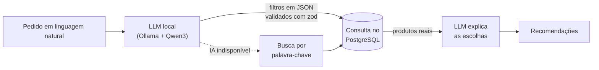

# Next Store

**E-commerce completo de teclados mecânicos, com marcas fictícias, configurador visual, drops de edição limitada e um assistente de compras com IA rodando 100% local.**


> 🚧 **Em construção.** O projeto está sendo desenvolvido em fases e em público: acompanhe o andamento no [roadmap](#roadmap).

<!-- Quando houver telas prontas, adicionar aqui um GIF da loja em uso. -->

## Sobre o projeto

A Next Store é uma loja online de teclados mecânicos e periféricos. Todo o catálogo é fictício: um universo próprio de marcas, com uma fabricante de teclados, uma de switches e um estúdio de keycaps, cada uma com identidade e produtos próprios.

A proposta é ir além do "CRUD de produtos com carrinho". A loja tem os fluxos de um e-commerce real (catálogo, carrinho, login, pagamento com Stripe, pedidos e painel administrativo) e três funcionalidades pouco comuns em lojas online, pensadas para resolver problemas reais de quem compra teclados: montar o próprio teclado, disputar lançamentos limitados e encontrar o produto certo descrevendo o que precisa em linguagem natural.

## Destaques

Os três diferenciais planejados, e o problema técnico por trás de cada um.

### 1. Configurador visual de teclado

O usuário monta o teclado em etapas: **layout → case → switches → keycaps**. A prévia e o preço mudam a cada escolha, e a configuração fica salva na URL, então dá para compartilhar o link do teclado montado.

- A prévia é um **SVG gerado a partir de dados** (layout, cores e materiais). O mesmo componente gera as imagens de todos os produtos da loja, o que garante uma identidade visual consistente sem depender de um banco de fotos.
- O preço é calculado por uma **função pura e testada**, usada tanto na interface quanto no servidor. O valor exibido e o valor cobrado nunca divergem.

### 2. Drops de edição limitada

Lançamentos com data e hora marcadas, contagem regressiva e estoque limitado, com as unidades restantes atualizadas ao vivo.

O desafio é a concorrência: quando duas pessoas tentam comprar a última unidade ao mesmo tempo, só uma pode conseguir. Em vez de "ler o estoque, checar, depois gravar", que deixa uma janela para vender a mais, o estoque é baixado numa única operação atômica no banco:

```sql
UPDATE drop_items
SET stock = stock - 1
WHERE id = $1 AND stock > 0
RETURNING stock;
```

Se nenhuma linha voltar, o produto esgotou, e a segunda compra é recusada.

### 3. Assistente de compras com IA local

O usuário escreve o que procura, como _"quero um teclado silencioso pro escritório, até R$ 600"_, e recebe recomendações do catálogo com uma explicação curta de cada escolha.



- **A IA não inventa produtos.** O modelo não escolhe nada sozinho: ele só traduz o pedido em filtros estruturados (categoria, faixa de preço, tipo de switch, uso). Os filtros são validados com zod e viram uma consulta comum ao banco, então todo resultado existe no catálogo.
- **Custo zero.** O modelo roda localmente com [Ollama](https://ollama.com), sem API paga.
- **Funciona mesmo sem IA.** Se o modelo não estiver disponível, por exemplo no deploy público, a busca cai automaticamente para palavra-chave, e a interface avisa.

## Decisões técnicas

| Decisão                                      | Por quê                                                                                                                             |
| -------------------------------------------- | ----------------------------------------------------------------------------------------------------------------------------------- |
| Preços guardados em **centavos** (inteiros)  | Evita erros de arredondamento de ponto flutuante. A formatação em reais fica só na exibição (`Intl.NumberFormat`).                  |
| O **servidor é a fonte da verdade** do preço | O navegador envia só IDs e quantidades. Checkout e configurador recalculam tudo no servidor, então o preço não pode ser adulterado. |
| **Estado na URL** (filtros, configurador)    | Links compartilháveis, botão "voltar" funcionando e nada se perde ao recarregar a página.                                           |
| Imagens de produto **geradas por código**    | Visual consistente, sem depender de fotos de terceiros, e o mesmo componente alimenta o configurador.                               |
| Baixa de estoque **atômica** no banco        | Impede vender mais unidades do que existem, mesmo com compras simultâneas.                                                          |
| IA restrita a **gerar filtros validados**    | Respostas sempre baseadas no catálogo real, sem produtos ou preços inventados.                                                      |
| Postgres em **Docker Compose**               | Qualquer pessoa reproduz o ambiente com um comando.                                                                                 |

## Stack

| Camada             | Tecnologia                                                           | Status       |
| ------------------ | -------------------------------------------------------------------- | ------------ |
| Framework          | Next.js 16 (App Router, Server Components, Server Actions), React 19 | ✅ em uso    |
| Linguagem          | TypeScript (modo strict)                                             | ✅ em uso    |
| Estilo             | Tailwind CSS v4                                                      | ✅ em uso    |
| Testes             | Vitest                                                               | ✅ em uso    |
| Qualidade          | ESLint, Prettier                                                     | ✅ em uso    |
| CI                 | GitHub Actions (lint, tipos, testes e build em cada PR)              | 🔜 planejado |
| Estado do carrinho | Zustand, com persistência local                                      | 🔜 planejado |
| Banco de dados     | PostgreSQL + Drizzle ORM                                             | 🔜 planejado |
| Autenticação       | Better Auth                                                          | 🔜 planejado |
| Pagamentos         | Stripe Checkout (modo de teste) + webhooks                           | 🔜 planejado |
| IA                 | Ollama + Qwen3, rodando localmente                                   | 🔜 planejado |
| Deploy             | Vercel + Neon (Postgres serverless)                                  | 🔜 planejado |

## Roadmap

O desenvolvimento segue em fases. Cada funcionalidade é feita numa branch própria e entra na `main` por Pull Request.

**Fase 0: Fundação**

- [x] Setup do projeto: TypeScript, Tailwind, ESLint, Prettier e Vitest
- [ ] CI com GitHub Actions
- [ ] Design system e identidade visual

**Fase 1: Catálogo**

- [ ] Universo de marcas e produtos fictícios
- [ ] Prévia de teclado em SVG gerada a partir de dados
- [ ] Home com destaques e marcas
- [ ] Página de produto com seleção de variantes
- [ ] Listagem com filtros e ordenação na URL

**Fase 2: Carrinho**

- [ ] Carrinho persistente, com drawer e controle de quantidade

**Fase 3: Backend**

- [ ] Banco de dados PostgreSQL com Drizzle e seed do catálogo
- [ ] Cadastro e login
- [ ] Checkout com Stripe e criação de pedidos via webhook
- [ ] Histórico de pedidos

**Fase 4: Administração**

- [ ] Painel admin com gestão de produtos e estoque
- [ ] Dashboard de vendas

**Fase 5: Diferenciais**

- [ ] Configurador visual de teclado
- [ ] Drops de edição limitada
- [ ] Assistente de compras com IA local
- [ ] Busca rápida com <kbd>Ctrl</kbd> + <kbd>K</kbd>

**Fase 6: Polimento e deploy**

- [ ] Animações e transições entre páginas
- [ ] Acessibilidade e performance (Lighthouse)
- [ ] Deploy na Vercel

## Rodando localmente

Requisitos: **Node.js 22+**.

```bash
git clone https://github.com/joaovsimplicio/e-commerce.git
cd e-commerce
npm install
npm run dev
```

Abra [http://localhost:3000](http://localhost:3000).

As próximas fases vão adicionar Docker (para o PostgreSQL), a Stripe CLI (para os webhooks) e o Ollama (para a IA). As instruções de cada um entram aqui conforme forem necessárias.

### Scripts

| Comando                | O que faz                              |
| ---------------------- | -------------------------------------- |
| `npm run dev`          | Servidor de desenvolvimento            |
| `npm run build`        | Build de produção                      |
| `npm run start`        | Roda o build de produção               |
| `npm run lint`         | ESLint                                 |
| `npm run format`       | Formata o código com Prettier          |
| `npm run format:check` | Verifica a formatação sem alterar nada |
| `npm test`             | Roda os testes uma vez                 |
| `npm run test:watch`   | Roda os testes em modo watch           |

## Estrutura do projeto

```
app/          rotas (App Router)
components/   componentes React (ui/, layout/, product/...)
lib/          regras de negócio, utilitários e integrações
data/         dados fictícios do catálogo e seed do banco
db/           schema e migrations do banco
```

## Fluxo de desenvolvimento

- Uma branch por funcionalidade (`feat/cart`, `feat/configurator`), integrada à `main` por Pull Request.
- Commits pequenos, cada um com uma única mudança, no padrão [Conventional Commits](https://www.conventionalcommits.org), em inglês.
- Rotas e código em inglês; textos da interface em português.
- Todo PR precisa passar por lint, checagem de tipos, testes e build.

## Autor

Desenvolvido por [@joaovsimplicio](https://github.com/joaovsimplicio).
